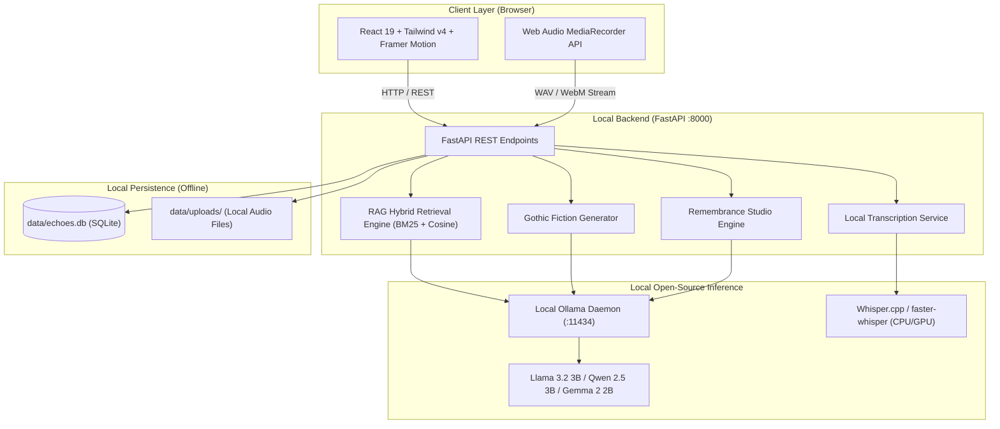

# Echoes — The Offline Memory Keeper

> *"Some voices deserve to live forever."*

[](https://hacktoberfest.com/)
[]()
[](LICENSE)
[]()
[]()

Echoes is a **privacy-first family memory vault** that preserves oral histories, anecdotes, recipes, and personal narratives using **100% local, open-source AI**.

Built for the **Hacktoberfest Open-Source AI Challenge Week 4: *Ghost in the Machine***.

---

## Ethical Non-Mediumship Manifesto

> [!IMPORTANT]
> **Echoes is a memory preservation tool, not a supernatural medium.**
> It never pretends to communicate with deceased people or channel spirits from beyond the grave. The AI acts strictly as an archival assistant reading human-recorded stories. Its creative *"Ghost Story Mode"* is prominently labeled as **100% artistic fiction inspired by keepsake motifs**.

---

## Architecture Overview



---

## Core Capabilities

### 1. 🏛️ Memory Vault
- Preserve stories with **title, person, date/era, narrative, and tags**.
- Record voice stories directly in the browser or upload audio files (`.wav`, `.mp3`, `.m4a`, `.webm`).
- Real-time search by keyword, relative, tag, or spoken transcript.
- Favorite keepers with 1-click star filtering.
- One-click export of any memory as **Markdown** or **JSON**.

### 2. 🎙️ Local Voice Transcription
- Transcribe audio recordings locally using open-source **Whisper**.
- Review and edit transcripts directly inside the UI.
- No audio data ever leaves your computer.

### 3. 📻 AI Memory Assistant (RAG)
- Conversational assistant powered by **local Retrieval Augmented Generation (RAG)**.
- **Strictly answers using only your saved memories.**
- Direct **source attribution** badge for every cited story.
- Refuses to hallucinate or invent family history.
- Model selector: seamlessly switch between local models (`llama3.2:3b`, `qwen2.5:3b`, `gemma2:2b`).

### 4. 🕯️ Remembrance Studio
- Create a digital remembrance tribute honoring a loved one.
- Preserves their comfort dishes, beloved melodies, and words they lived by.
- Generates a warm, dignified memorial message with local AI.
- Exports a **standalone printable HTML page** styled with dark candlelight & marigold aesthetics (includes print media CSS for physical printing or PDF saving).

### 5. 👻 Ghost Story Mode (The Hacktoberfest Creative Track)
- Retro cyber-gothic CRT scanline terminal interface.
- Weaves props and keepsake motifs from chosen memories into spooky gothic campfire fiction.
- **Adjustable Horror Intensity Slider (Levels 1 to 5)**:
  - Level 1: *Cozy Twilight*
  - Level 2: *Eerie Whispers*
  - Level 3: *Midnight Haunting*
  - Level 4: *Dark Apparition*
  - Level 5: *Gothic Nightmare*
- High-visibility banner guaranteeing **100% fictional creative writing**.

### 6. 🛡️ 100% Offline & Private
- Zero telemetry.
- Zero external AI API calls (never calls OpenAI, Gemini, or Claude).
- Complete portability: full vault export to `echoes_vault_backup.json` or `echoes_complete_memories.md`.

---

## Project Structure

```
ghost-in-the-machine/
├── frontend/               # React 19 + TypeScript + Vite + Tailwind v4
│   ├── src/
│   │   ├── components/     # UI Views & Modals (Vault, Assistant, Remembrance, Ghost Story)
│   │   ├── services/       # Typed REST API Client
│   │   ├── types.ts        # TypeScript data contracts
│   │   ├── App.tsx         # Central application state & views
│   │   └── index.css       # Candle flame glow, CRT scanlines, typography
│   └── vite.config.ts      # Tailwind plugin + API reverse proxy
├── backend/                # Python FastAPI Backend
│   └── app/
│       ├── main.py         # FastAPI application entrypoint
│       ├── config.py       # Configuration & offline flags
│       ├── database.py     # SQLite engine & session management
│       ├── models.py       # SQLAlchemy ORM models
│       ├── schemas.py      # Pydantic v2 schemas
│       ├── routers/        # API route handlers (memories, assistant, ghost, remembrance)
│       └── services/       # Ollama client, RAG engine, Whisper transcription
├── data/
│   ├── sample_memories.json # Pre-packaged fictional demo stories
│   └── uploads/            # Local audio recordings & photo storage
├── docs/
│   ├── ARCHITECTURE.md     # Deep-dive technical architecture
│   └── DEVTO_SUBMISSION.md # Official Hacktoberfest 2026 submission post
├── tests/
│   └── test_api.py         # Pytest test suite (100% passing)
├── scripts/
│   ├── run_all.ps1         # Windows PowerShell launcher
│   ├── run_backend.bat     # Windows batch backend launcher
│   ├── run_frontend.bat    # Windows batch frontend launcher
│   └── seed_memories.py    # Database seeder script
├── .env.example            # Environment variables template
├── docker-compose.yml      # Container orchestration
├── Dockerfile              # Multi-stage container build
├── LICENSE                 # MIT License
├── README.md               # Documentation
└── requirements.txt        # Python backend dependencies
```

---

## Getting Started (Windows Quickstart)

### Prerequisites
1. **Python 3.11+** installed.
2. **Node.js 18+** installed.
3. **Ollama** installed from [https://ollama.com](https://ollama.com).

---

### Step 1: Install Ollama & Pull a Model

Open Windows PowerShell:

```powershell
# Verify Ollama installation
ollama --version

# Pull the lightweight 3B model (choose either)
ollama pull llama3.2:3b
# or
ollama pull qwen2.5:3b
```

Ensure Ollama is running in the background:
```powershell
ollama serve
```

---

### Step 2: Set Up Python Backend

Open a new PowerShell terminal:

```powershell
cd ghost-in-the-machine

# Create and activate virtual environment (optional if using system python)
python -m venv .venv
.venv\Scripts\activate

# Install backend dependencies
pip install -r requirements.txt

# Run backend test suite to verify everything is working
pytest tests/test_api.py -v

# Start the FastAPI backend server
cd backend
python -m uvicorn app.main:app --host 127.0.0.1 --port 8000 --reload
```

The backend is now live at: `http://127.0.0.1:8000`  
Interactive Swagger API Docs: `http://127.0.0.1:8000/docs`

---

### Step 3: Set Up and Launch Frontend

Open another PowerShell terminal:

```powershell
cd ghost-in-the-machine\frontend

# Install dependencies
npm install

# Start Vite development server
npm run dev
```

Visit the app in your browser:  
👉 **`http://localhost:5173`**

*(Or double-click `scripts\run_all.ps1` to launch both services in parallel!)*

---

## API Endpoints Reference

| Method | Endpoint | Description |
|---|---|---|
| `GET` | `/api/health` | Health status, database verification, local Ollama models list |
| `GET` | `/api/memories` | List memories with search query `?q=`, tag, and favorite filters |
| `POST` | `/api/memories` | Create a new family memory story |
| `GET` | `/api/memories/{id}` | Retrieve individual memory details |
| `PUT` | `/api/memories/{id}` | Update memory details |
| `DELETE`| `/api/memories/{id}` | Delete memory and attached audio |
| `POST` | `/api/memories/{id}/upload-audio` | Attach spoken voice recording file |
| `POST` | `/api/memories/{id}/transcribe` | Transcribe attached audio with local Whisper |
| `POST` | `/api/memories/seed` | Seed 5 pre-populated fictional sample memories |
| `POST` | `/api/assistant/chat` | RAG query over memories with strict citations |
| `GET` | `/api/assistant/history` | Retrieve conversational turns |
| `DELETE`| `/api/assistant/history`| Clear conversation history |
| `POST` | `/api/ghost-story/generate` | Generate fictional gothic tale with horror intensity |
| `POST` | `/api/remembrance/generate` | Synthesize respectful tribute for loved one |
| `POST` | `/api/remembrance/profiles` | Save remembrance memorial profile |
| `GET` | `/api/remembrance/profiles/{id}/printable` | Render standalone printable HTML memorial |
| `GET` | `/api/export/{id}` | Export single memory as Markdown or JSON |
| `GET` | `/api/export/all/json` | Download full vault JSON backup |
| `GET` | `/api/export/all/markdown` | Download complete memories Markdown book |

---

## Test Verification

The backend test suite verifies all endpoints, RAG constraints, and model error handling:

```powershell
pytest tests/test_api.py -v
```

Output:
```
tests/test_api.py::test_health_endpoint PASSED                           [ 14%]
tests/test_api.py::test_seed_and_list_memories PASSED                    [ 28%]
tests/test_api.py::test_search_memories PASSED                           [ 42%]
tests/test_api.py::test_create_and_delete_memory PASSED                  [ 57%]
tests/test_api.py::test_assistant_chat_rag PASSED                        [ 71%]
tests/test_api.py::test_ghost_story_generation PASSED                    [ 85%]
tests/test_api.py::test_remembrance_tribute_generation PASSED            [100%]
============================== 7 passed in 1.36s ===============================
```

Frontend production build verification:
```powershell
cd frontend
npm run build
```
Output:
```
✓ 2055 modules transformed.
dist/index.html                   1.43 kB
dist/assets/index-CWtmDYtI.css   55.01 kB
dist/assets/index-hAhT7oCQ.js   319.51 kB
✓ built in 2.13s
```

---

## License

Released under the **MIT License**. See [LICENSE](LICENSE) for details.
Preserve your family's voices in total privacy.
